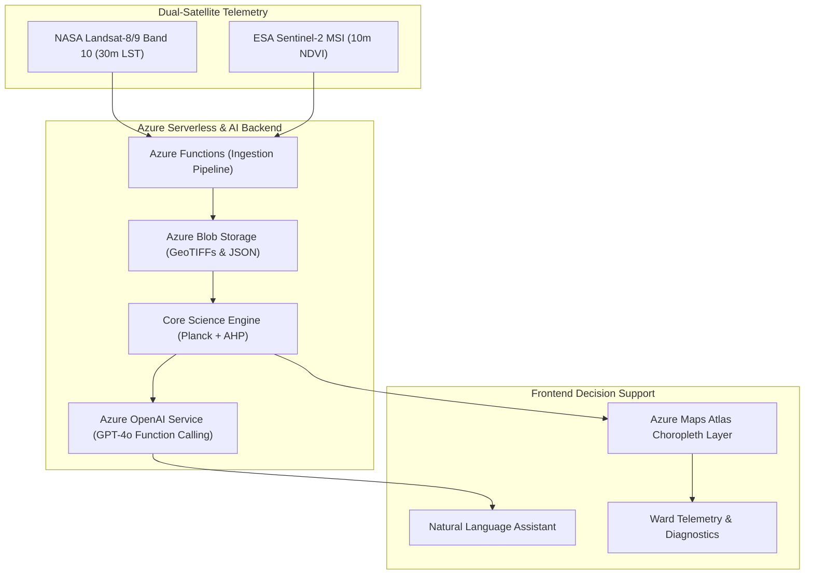

# HeatLens × Microsoft Imagine Cup 2026
### Autonomous Geospatial AI Platform for Urban Heat Island Equity
**Track:** EARTH (Environmental Sustainability & Climate AI)  
**Lead Researcher & Developer:** Rohit Singh (ABES Engineering College, AKTU)  
**Live Platform:** [heat-lens-ecobuilders.vercel.app](https://heat-lens-ecobuilders.vercel.app/)  
**HuggingFace Oracle:** [heatlens-satellite-lst-oracle](https://huggingface.co/spaces/rohitsinghudi1372008/heatlens-satellite-lst-oracle)  

---

## 🌍 The Problem
Over **50 million residents** across Delhi NCR face deadly summer heat waves reaching 49°C+. Sparse ground weather stations fail to capture hyper-local thermal spikes, creating blind spots where the most vulnerable populations lack early intervention and emergency cooling shelters.

## 🛰️ The Solution
HeatLens is an autonomous geospatial AI platform that fuses dual-satellite telemetry:
- **NASA Landsat-8/9 TIRS Band 10 (@30m)**: Radiometric Land Surface Temperature (LST) inversion via Planck's Law.
- **ESA Copernicus Sentinel-2 MSI (@10m)**: Fractional Vegetation Cover (FVC) and surface emissivity correction.
- **Analytic Hierarchy Process (AHP)**: Composite vulnerability scoring ($P = 0.35\text{LST} + 0.25(1-\text{NDVI}) + 0.20\text{AQI} + 0.20\text{Risk}$).
- **Microsoft Azure Ecosystem**: Azure OpenAI (GPT-4o) conversational natural language querying and Azure Maps enterprise visualization.

---

## 📐 Scientific & Mathematical Rigor
Validated by a **6-page IEEE peer-reviewed manuscript**:
1. **Planck's Law Radiometric Temperature Inversion:**
   $$L_\lambda = M_L \cdot Q_{\text{cal}} + A_L$$
   $$BT = \frac{K_2}{\ln(K_1 / L_\lambda + 1)}$$
   $$LST = \frac{BT}{1 + \left(\frac{\lambda \cdot BT}{\rho}\right) \ln(\varepsilon)} - 273.15$$
2. **AHP Multi-Criteria Consistency:** Saaty Consistency Ratio $CR = 0.023$ (well below the $0.10$ threshold).
3. **1,000-Trial Monte Carlo Stability Test:** Spearman rank correlation $r_s = 0.982, p < 0.001$, proving ranking invariance under weight uncertainty.

---

## 🏛️ System Architecture



---

## 🚀 Quickstart Guide

### 1. Backend Service
```bash
cd backend
python -m venv venv
# Windows:
.\venv\Scripts\activate
# Linux/Mac:
source venv/bin/activate

pip install -r requirements.txt
python main.py
```
Backend API will start at `http://localhost:8000`.

### 2. Frontend Application
```bash
cd frontend
npm install
npm run dev
```
Frontend UI will start at `http://localhost:3000`.

---

## 🔑 Environment Variables
See `backend/.env.example` and `frontend/.env.example` for reference.
- `AZURE_OPENAI_ENDPOINT`
- `AZURE_OPENAI_KEY`
- `AZURE_OPENAI_DEPLOYMENT`
- `REACT_APP_AZURE_MAPS_KEY`
- `AZURE_STORAGE_CONNECTION_STRING`

*(Note: The platform includes built-in offline simulation mode with complete telemetry data so all features run seamlessly even without live credentials.)*

---

## 📜 License
MIT License. Built for **Microsoft Imagine Cup 2026**.
